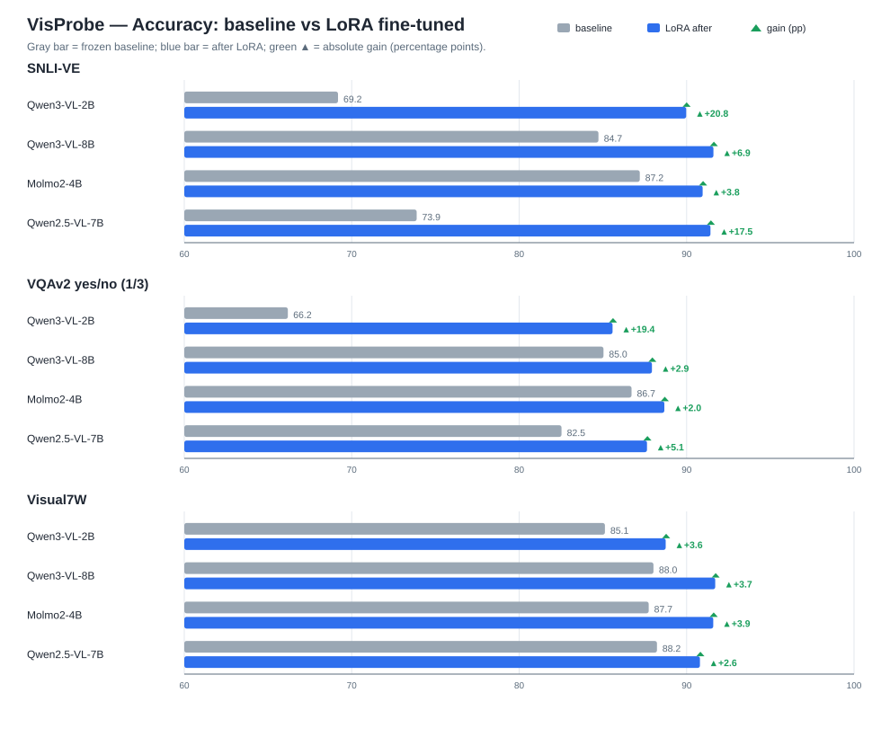

# VisProbe · Vision-Text Probabilistic Classification with Lightweight VLMs

> **Vis**ion **Pro**babilistic Classifi**e**r — a lightweight framework that treats
> open-source vision-language models (VLMs) as **probabilistic visual classifiers**.
> Instead of generating free-form text, it reads the **answer-token logits and applies a
> softmax over the candidate codes**, producing a calibrated, auditable probability distribution.

## Why VisProbe

The motivating question: **what can lightweight open-source VLMs (≤8B) do when used as
probabilistic decision-makers, rather than chatbots?**

Probability outputs (instead of plain labels) make model behaviour:

- **Quantifiable** — every decision carries a confidence score and a distribution over options;
- **Calibratable** — reliability is measurable (ECE / Brier) and improvable (temperature scaling);
- **Auditable** — a decision can be traced to specific token probabilities, thresholds, and data.

Three principles guide the project:

1. **Lightweight** — everything runs on a single consumer GPU (RTX 3090 24GB), including
   fine-tuning; models span 2B–8B parameters.
2. **Probabilistic** — tasks are cast as closed-set choice/boolean classification scored from
   answer-token logits; no text parsing, no sampling.
3. **Closed-loop** — every model follows the same pipeline:
   *frozen baseline evaluation → LoRA fine-tuning → same-protocol after evaluation*,
   so improvement is always measured against the model's own baseline on identical test sets.

## Datasets

Three established vision-language benchmarks, all expressed in the same unified JSONL schema
(image + prompt + closed candidate set + answer code):

| Dataset | Task | Test set |
|---|---|---|
| **SNLI-VE** | visual entailment, 3-way (entailment / neutral / contradiction) | full test, 21,482 |
| **VQAv2 yes/no** | boolean visual question answering | seeded random 1/3 of test, 26,846 |
| **Visual7W** | multiple-choice visual QA (A–D) | full test, 6,695 |

Fine-tuning uses a stratified, label-balanced **100k mixed subset** (33,333 per dataset,
seed=42, one epoch). The 1/3 VQAv2 test subset reduces evaluation cost by ~74% with a
standard error under ±0.5 percentage points.

## Models & status

| Short name | Model | Family | Status |
|---|---|---|---|
| `qwen3vl2b` | Qwen/Qwen3-VL-2B-Instruct | qwen3_vl | ✅ baseline + after |
| `qwen3vl8b` | Qwen/Qwen3-VL-8B-Instruct | qwen3_vl | ✅ baseline + after |
| `molmo4b` | allenai/Molmo2-4B | molmo2 | ✅ baseline + after |
| `qwen7b` | Qwen/Qwen2.5-VL-7B-Instruct | qwen2_vl | ✅ baseline + after |
| ~~`qwen3b`~~ | Qwen/Qwen2.5-VL-3B-Instruct | qwen2_vl | ⛔ retired (baseline retained for reference) |

All fine-tuning is **LoRA only on the language decoder** (rank 8, ~0.25–0.5% trainable
parameters; vision tower frozen). The trained adapters are published on the Hugging Face Hub:

| Model | LoRA adapter (Hugging Face) | Size |
|---|---|---|
| Qwen3-VL-2B | [chenyeikai/VisProbe-Qwen3-VL-2B-LoRA](https://huggingface.co/chenyeikai/VisProbe-Qwen3-VL-2B-LoRA) | 49 MB |
| Qwen3-VL-8B | [chenyeikai/VisProbe-Qwen3-VL-8B-LoRA](https://huggingface.co/chenyeikai/VisProbe-Qwen3-VL-8B-LoRA) | 99 MB |
| Qwen2.5-VL-7B | [chenyeikai/VisProbe-Qwen2.5-VL-7B-LoRA](https://huggingface.co/chenyeikai/VisProbe-Qwen2.5-VL-7B-LoRA) | 107 MB |
| Molmo2-4B | [chenyeikai/VisProbe-Molmo2-4B-LoRA](https://huggingface.co/chenyeikai/VisProbe-Molmo2-4B-LoRA) | 55 MB |

Browse all four in one place: [**VisProbe collection on the Hugging Face Hub**](https://huggingface.co/collections/chenyeikai/visprobe-lightweight-vlms-as-probabilistic-classifiers-6ac9b0abe431a8f2d554a8ba).

Adapters are evaluated directly without weight merging (`PeftModel.from_pretrained`). They can
also be reproduced locally with the documented training commands.

## Results — baseline vs LoRA

Accuracy per dataset; gray bars are frozen baselines, blue bars are after LoRA, and green ▲
marks the absolute gain in percentage points:



Three-dataset **macro average** accuracy (each dataset weighted equally):

| Model | baseline | after LoRA | Δacc |
|---|---|---|---|
| Qwen3-VL-8B | 0.859 | **0.904** | +0.045 |
| Molmo2-4B | 0.872 | **0.904** | +0.032 |
| Qwen2.5-VL-7B | 0.815 | 0.900 | +0.084 |
| Qwen3-VL-2B | 0.735 | 0.881 | **+0.146** |

After fine-tuning, the 8B and Molmo2-4B tie at the top (0.904), with the 7B close behind
(0.900). The 2B gains the most (+14.6 points) at roughly half the training time of the 8B —
the best accuracy-per-compute point; the 7B shows the largest *calibration* improvement
(macro ECE 0.133 → 0.025).
Full acc/ECE/Brier tables: [`results/SUMMARY.md`](results/SUMMARY.md);
per-step loss/lr curves: [`results/loss_curves.csv`](results/loss_curves.csv).

## Quick start

```bash
bash setup.sh
cp .env.example .env          # set HF_ENDPOINT (mirror/proxy) and optional model ids
source .venv/bin/activate

# Smoke test: load a model and score one image
python - <<'PY'
from vlm.scoring.vlm_scorer import VLMScorer
VLMScorer("qwen3vl2b"); print("OK")
PY
```

End-to-end reproduction for one model (data → subset → baseline → fine-tune → after):

```bash
bash scripts/reproduce.sh qwen3vl8b
```

See [`EXPERIMENTS.md`](EXPERIMENTS.md) for exact hyperparameters, commands, hardware, and
wall-clock times.

## Repository layout

```
vlm/
├── scoring/     serving_schema.py  vlm_scorer.py  calibration.py
├── training/    model_loading.py  lora_train.py  molmo_patch.py
├── datasets/    public_benchmarks.py  distill.py  qc.py  orchestrator.py
├── evaluation/  metrics.py  evaluate.py  compare.py  summarize.py
└── quantize.py
scripts/         batch eval / subset sampling / pipeline / chart / reproduce
results/         metric JSONs + SUMMARY.md + loss curves + figure (tracked in git)
docs/            design, runbook, experiment notes, archive
requirements/    vlm.txt  quant.txt
data/{raw,processed,heldout,subsets}/   # not in git — generated by scripts
models/                                  # not in git — local LoRA adapters
```

## Documentation

- [`EXPERIMENTS.md`](EXPERIMENTS.md) — exact reproduction protocol, hyperparameters, timings, lessons
- [`results/SUMMARY.md`](results/SUMMARY.md) — full baseline/after result tables
- [`docs/DESIGN.md`](docs/DESIGN.md) — architecture, data schema, scorer design
- [`docs/RUNBOOK.md`](docs/RUNBOOK.md) — step-by-step runbook
- [`docs/molmo2-training-fix.md`](docs/molmo2-training-fix.md) — Molmo2 remote-code compatibility fix
- [`PLAN.md`](PLAN.md), [`docs/archive/`](docs/archive/) — historical planning documents (archived)

## Future directions

The framework is currently validated on three academic benchmarks. Because the output is a
**probability distribution over explicit options**, it maps naturally onto risk-driven
production workflows:

- **Ad / content moderation** — output a risk probability distribution that drives a
  three-way routing decision: *block / send to human review / approve*. Thresholds can be
  tuned per policy and audited through ECE.
- **Pathology triage** — benign / borderline / malignant class probabilities serve as a
  structured "second reader"; cases are ranked by risk probability to minimise missed
  positives and prioritise reviewer attention.
- **Financial analysis** — probabilities extracted from financial charts, reports, and
  receipts (e.g. signal strength, fraud or default risk) feed downstream risk models for
  tiered decision-making rather than a single hard label.

### Code modules without experimental results yet

These modules exist in the repository but have **no reported experiment results yet**; they
are documented for completeness and are **not part of the delivered benchmark**:

- `vlm/scoring/calibration.py` — temperature scaling for post-hoc confidence calibration;
- `vlm/datasets/distill.py` — soft-label distillation data generation (external teacher API);
- `vlm/quantize.py` — 4-bit quantization utilities.

See [PLAN.md](PLAN.md) for the longer-term roadmap.

## Data attribution & license

This repository **does not redistribute any third-party images or annotations**. Raw data is
downloaded via the conversion scripts from Hugging Face and remains subject to its upstream
licenses:

- **SNLI-VE** — based on SNLI and Flickr30k images;
- **VQAv2 yes/no** — based on VQAv2 and COCO images;
- **Visual7W** — based on Visual Genome.

Model weights belong to their respective owners (Qwen models: Apache-2.0; Molmo2: AI2 license)
and follow their model-card terms. This project's own code is released under the
[Apache License 2.0](LICENSE).
